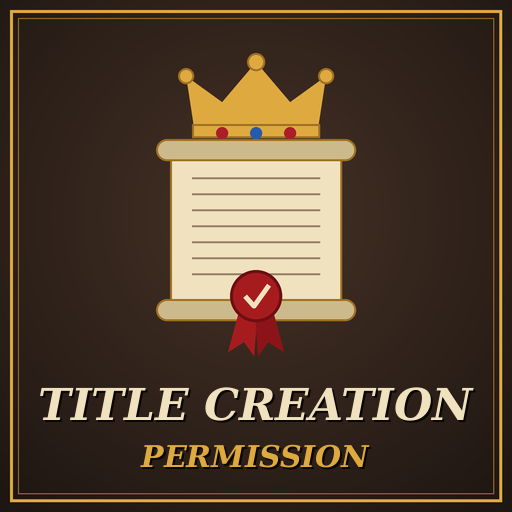

# Title Creation Permission

A Crusader Kings III mod that puts title creation in the hands of the crown. In a feudal realm with Absolute Crown Authority (or the level you choose), or in an administrative empire, vassals can no longer create duchies, kingdoms or empires on their own: they have to ask their top liege for permission. New titles in your realm are only made when you allow it, so you are the one who hands them out.

- **Game version:** 1.20.x
- **Mod version:** 1.1.1
- **Author:** [Sourenics](https://github.com/Sourenics)
- **Steam Workshop:** [Title Creation Permission](https://steamcommunity.com/sharedfiles/filedetails/?id=3827886721)

## Features

Vassals need their **top liege's permission** to create a title when the top liege is a player and:

- has the **feudal** government with **Absolute Crown Authority** (the fourth and highest Crown Authority level; a lower level can be chosen with a game rule), or
- has the **administrative** government and an **empire** (or higher) as primary title.

This applies to every vassal in the realm, direct or indirect, whatever their own government.

**Asking for permission.** Vassals have a new interaction, **Request Title Creation**, on their top liege. They choose the title they want to create, and the liege accepts or refuses. A vassal who is refused gets **−30 opinion** of their liege for 10 years (*Refused My Title Creation*). AI vassals only ask for titles they could create, those whose de jure counties they mostly control, and not often: each vassal asks at most once every 2 years, and a liege receives at most one request a year from AI vassals, so large realms are not flooded with them.

**Letters from your vassals.** A request arrives as a letter that names the title. What the vassal writes depends on who they are, what they think of you and what they ask for; the first that fits is used:

- **A rival, or a vassal who dislikes you,** asks coldly, because the law demands it, and warns you not to refuse out of spite.
- **A vassal whose dynasty once held the title** asks to restore what their forefathers lost.
- **Your primary heir** wants to prove they can bear the weight of what they will one day inherit.
- **Close family** writes as your own blood, promising that the honor will reflect on the whole family.
- **A friend, or a vassal who likes you,** appeals to years of faithful service.
- **An ambitious vassal** makes no secret of meaning to rise.
- **An arrogant vassal** treats your permission as a mere formality.
- **A humble or content vassal** hardly dares to ask.
- **A vassal of great renown** (prestige level 4 or higher) asks for a title worthy of their name.
- **A vassal asking for a kingdom or an empire** knows that no crown in your realm is raised but by your hand.
- **Anyone else** writes a formal, dutiful request.

Each kind of vassal has **two letters**, picked at random when the request is sent, so the same vassal does not always write the same words.

**Your vassal's answer.** When you accept or refuse a request, or grant permission unasked, the vassal reacts in a message of their own, shown in your message feed so it does not interrupt the game: a rival grudgingly acknowledges your permission or vows to remember your refusal, an ambitious vassal calls it only the beginning or swears to find another way to rise, an arrogant one expected nothing less or laughs bitterly, a humble one is overwhelmed or apologizes for asking, family speaks of blood, a loyal vassal kneels or obeys without understanding.

**Granting permission.** The top liege has a new interaction, **Grant Title Creation**, to give a vassal permission for a title without being asked.

**The permission** is for one specific title and lasts **5 years**. It is used up when the vassal creates that title. The vassal still has to meet the usual requirements to create it (de jure counties, cost). The title creation screen shows when permission is missing.

Everything else stays vanilla: independent rulers, vassals of other governments or with a lower Crown Authority than required, and the top liege themselves create titles as usual.

### Game rules

The game rule **TCP: Title Creation Permission** turns the restriction on or off:

- **Player Realms** (default): every vassal of a player top liege needs the player's permission, including the vassals of an AI king under a player emperor, since only the top liege counts.
- **Vanilla:** titles are created as in vanilla.

Realms ruled by the AI are never affected, so the AI keeps creating titles as in vanilla and stays as unpredictable as ever.

The game rule **TCP: Required Crown Authority** sets the lowest Crown Authority at which a feudal top liege requires permission:

- **Absolute** (default): only with Absolute Crown Authority.
- **High or higher**: with High or Absolute Crown Authority.
- **Limited or higher**: with Limited, High or Absolute Crown Authority.
- **Any**: always, even with Autonomous Vassals.

Administrative emperors always require permission, whatever this rule says.

### Languages

The interface texts are in English and Spanish; players using any other game language see them in English. Translations are welcome: open an [issue](../../issues/new/choose) or post them on the Steam Workshop page.

## Installation

### Steam Workshop

Subscribe on the Steam Workshop page and enable the mod in the Paradox launcher.

### Manual

1. Download this repository (green **Code** button → **Download ZIP**).
2. Copy the contents of the `mod/` folder (`title_creation_permission/` and `title_creation_permission.mod`) into:
   - **Windows:** `Documents/Paradox Interactive/Crusader Kings III/mod/`
   - **Linux:** `~/.local/share/Paradox Interactive/Crusader Kings III/mod/`
   - **macOS:** `~/Documents/Paradox Interactive/Crusader Kings III/mod/`
3. Enable **Title Creation Permission** in the Paradox launcher.

## Compatibility

- Works without DLC. The administrative government needs **Roads to Power**.
- Overrides the vanilla scripted rule `can_create_title` from `common/scripted_rules/00_rules.txt` in its own file. In vanilla this rule is empty and left for modders, so no vanilla behaviour is lost, but other mods that override the same rule are not compatible without a patch. No other scripted rule is changed.
- Adds to the `on_title_gain` on_action without overriding it.
- The restriction applies to title creation through the title screen, which is where the game checks `can_create_title`. Titles formed through decisions or events may not be affected.
- Can be added to an existing save and removed at any time.

## Reporting bugs

Please open an [issue](../../issues/new/choose) using the **Bug report** template. To be able to fix the problem we need:

1. **The `error.log` file** from the session where the problem happened:
   - **Windows:** `Documents/Paradox Interactive/Crusader Kings III/logs/error.log`
   - **Linux:** `~/.local/share/Paradox Interactive/Crusader Kings III/logs/error.log`
   - **macOS:** `~/Documents/Paradox Interactive/Crusader Kings III/logs/error.log`

   The log is overwritten every time the game starts, so copy it right after the problem happens, before launching the game again. Ideally, reproduce the problem in a session with **only Title Creation Permission enabled**.
2. **The game version** (shown in the main menu, for example 1.20.1) and **the mod version**.
3. **Your active DLCs** and **your full mod list in load order**.
4. **The situation:** the top liege's government and Crown Authority, the title being created, and whether you were the vassal or the liege.
5. **Screenshots** of the title creation screen or the interaction, if possible.

## Credits

Idea and testing by Sourenics.

## License

**Title Creation Permission** © 2026 Sourenics, licensed under [Creative Commons Attribution-ShareAlike 4.0 International (CC BY-SA 4.0)](https://creativecommons.org/licenses/by-sa/4.0/).

Forks, translations and alternative versions are welcome, provided that you:

- **Credit the original author** (Sourenics) and link to this repository.
- **Indicate the changes** you made.
- **Release your version under the same license** (CC BY-SA 4.0).

### Paradox Interactive content

Crusader Kings III and its content are © Paradox Interactive AB and are **not** covered by this license. This includes the comment header of the overridden `can_create_title` scripted rule, copied from Paradox script. This project is an unofficial fan-made mod, not affiliated with or endorsed by Paradox Interactive. Like every CK3 mod, it must be distributed free of charge.
